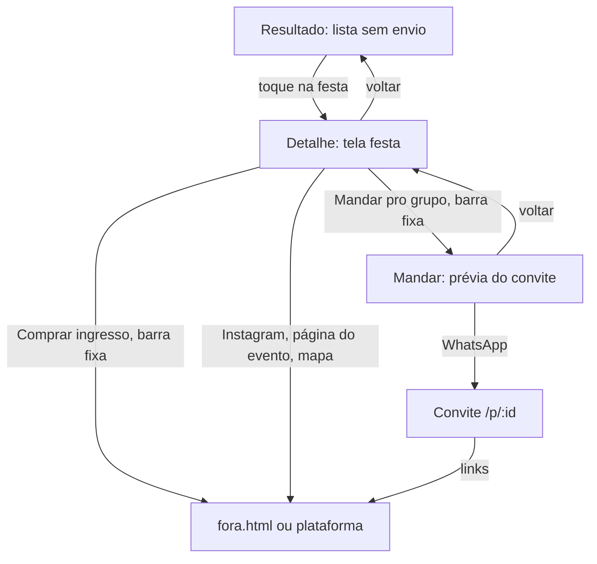

# Detalhe da festa antes do grupo - Plan

## Goal Capsule

**Objective.** Quem recebe as três festas do Finde consegue conferir, numa tela só, tudo o que hoje vai buscar no Instagram, na página de ingressos e no mapa, e só então manda a festa escolhida para o grupo.

**Means.** Uma página de detalhe da festa no protótipo visual (`prototipo/v1-festas`), entre o resultado e o envio ao grupo, com os dados que o motor de coleta vai de fato conseguir entregar.

**Product authority.** Caio, pelo Grupo 1. O protótipo visual é a área ativa desta peça. O motor de coleta, agregação e classificação é a área vizinha: este documento só fixa o que ele precisa entregar para sustentar a tela (R14 a R17), sem planejar como.

**Open blockers.** Nenhum. As perguntas abertas estão classificadas em Outstanding Questions.

**Esta execução.** Cobre R1 a R13 e R18 a R22 no protótipo visual. Os dados fictícios seguem o registro de R14 (KTD1), para o motor encaixar depois. R14 a R17 são da frente vizinha.

**Stop conditions.** Parar e perguntar se o encaixe com o motor exigir mudar o nome de um campo de R14 já usado pelo motor, ou se a barra fixa não couber a 320 px sem quebrar o botão.

**Execution profile.** Node 24 sem dependências. Commit, branch e push ficam com a sessão que integra.

## Product Contract

### Summary

O resultado deixa de ter "Mandar pro grupo" em cada festa. Tocar numa festa abre o detalhe: horário e média de idade primeiro, depois local, preço, os links de verdade (Instagram, página do evento, onde comprar), regras de entrada e som. O envio ao grupo e a compra ficam numa barra fixa no pé do detalhe. O protótipo continua visual, com dados fictícios, mas cada campo corresponde a algo que o motor sabe obter e mostra de onde veio.

### Problem Frame

O v1 leva a pessoa da lista direto ao grupo. Na vida real ninguém faz isso: antes de propor uma festa, a pessoa abre o Instagram para ver a cara do público e as edições passadas, confere preço e lote na plataforma de ingresso e olha onde fica. O protótipo, do jeito que está, demonstra um gesto que o público-alvo não faria e esconde a parte em que o Finde mais economiza esforço, que é juntar essas fontes. Nenhum app de eventos mostra média de idade do público, o dado que diferencia o Finde (`docs/pesquisa/2026-11-10-apps-de-eventos.md`), e por isso a tela precisa deixar claro de onde ele vem.

### Key Decisions

- **O protótipo desta peça é visual, não funcional.** O motor real é construído em paralelo, noutra frente. (session-settled: user-directed — chosen over continuar evoluindo o v1 funcional: o importante agora é a usabilidade alinhada à realidade de uso.) Governs R1, R14.
- **O envio ao grupo sai da lista e só acontece a partir do detalhe.** (session-settled: user-directed — chosen over manter "Mandar pro grupo" em cada festa: ninguém manda sem antes conferir.) Governs R3, R9.
- **Os links de origem fazem parte do produto.** Instagram, página do evento e onde comprar aparecem no detalhe; o Finde agrega e leva para fora, sem vender ingresso. (session-settled: user-directed — chosen over um detalhe só com dados resumidos.) Governs R7, R8.
- **Horário e média de idade abrem o detalhe.** Regra 3 da voz da marca (`docs/marca.md`), confirmada pelo benchmark: Sympla, DICE e Fever põem data e hora no topo. Governs R4, R5.
- **Todo dado mostra de onde veio e quando foi conferido.** A média de idade não existe em nenhuma fonte pública; o caminho realista é a produtora declarar. Governs R5, R12, R16.
- **A faixa de idade é preferência, não filtro.** A média é estimativa; a pessoa marca a faixa em que se sente bem com um seletor de dois pontos, como o de idade do Tinder, e festas fora dela continuam aparecendo, mais abaixo e com aviso. (session-settled: user-directed — chosen over as quatro faixas fixas que excluem: o dado não é exato o bastante para barrar.) O benchmark confirma o caminho: o Tinder tem um interruptor para mostrar quem está "um pouco fora" da faixa quando acabam os de dentro, e o Hinge só exclui quando a pessoa liga o "dealbreaker" (`docs/pesquisa/2026-11-10-faixa-de-idade-e-lugares.md`). O Finde fica sem esse interruptor por ora: tudo é preferência. Governs R20, R21, R22.
- **Bairros e regiões aceitam mais de uma escolha; o dia continua sendo um só.** (session-settled: user-directed — chosen over escolha única em tudo: ao escolher lugar, a pessoa costuma topar mais de um.) Nenhum app pesquisado confirmou escolha múltipla de bairros: Airbnb, Google Maps, iFood e QuintoAndar trabalham com uma área por vez. É aposta do Finde, a testar nas entrevistas. Governs R18, R19.
- **O que fica fora do pedido aparece separado, nunca misturado.** Quando faltam festas dentro das regiões ou da faixa, as de fora completam o resultado num bloco próprio e rotulado, depois das que cabem. (Recomendação do benchmark, adotada aqui: misturar faria a pessoa achar que o filtro falhou, como na revisão de 10/11.) Governs R19, R21.
- **Uma ação principal fixa no pé (padrão DICE), com o menor preço disponível.** O benchmark aponta a falha de mostrar preço de lote esgotado. Governs R7, R9.

### Requirements

**As perguntas**

- R18. O dia continua com escolha única (sexta, sábado ou domingo).
- R19. Uma pergunta de onde, com escolha múltipla: bairros agrupados por zona, em chips que se marcam e desmarcam, mais "Qualquer lugar" como chip exclusivo (marcá-lo limpa os outros). Sem mapa nesta peça. As festas das regiões marcadas vêm primeiro; se não bastam, as vizinhas completam o resultado num bloco à parte, "Perto das suas regiões".
- R20. A idade vira "a faixa em que você se sente bem": um seletor de intervalo com dois pontos, de 18 a 50 anos (o último ponto vale "50 ou mais"), que a pessoa arrasta; o padrão sai de 28 a 35.
- R21. Festas com média fora da faixa marcada continuam aparecendo, depois das que cabem e num bloco rotulado, com o aviso do quanto se afastam ("média 26, um pouco abaixo da sua faixa").
- R22. O seletor de idade funciona sem arrastar e com leitor de tela: cada ponto é um `slider` próprio no padrão de vários pontos do W3C, com o valor dito em anos, alvo de toque de 44 px e teclas de seta; os dois números também mudam por botões de passo.

**Do resultado ao detalhe**

- R1. O protótipo visual roda com dados fictícios e declara isso de forma discreta, como hoje.
- R2. Cada festa do resultado é tocável por inteiro e abre o detalhe; a lista mostra só o que serve para escolher: hora de início, pista cheia, média de idade, nome, bairro, preço a partir de e porquê.
- R3. A lista não oferece "Mandar pro grupo".

**O detalhe da festa, na ordem**

- R4. Topo: dia e horário de início, a hora em que a pista enche e o horário de fim, com a linha do tempo da festa contra a janela pedida.
- R5. Logo abaixo do horário, a média de idade com a origem do dado (informada pela produtora, estimada por edições anteriores ou por avaliações de quem foi) e a data em que foi conferida.
- R6. Cartaz ou foto, nome, produtora e casa, endereço e um link para abrir no mapa.
- R7. Preço do menor lote disponível e onde comprar, com a taxa da plataforma quando a fonte a dá e a regra de preço por horário quando houver ("R$ 20 até as 23h; depois, R$ 30"); quando a entrada é na porta, isso é dito no lugar do link.
- R8. Links de origem: Instagram da festa ou da produtora e página do evento, cada um rotulado com o nome do serviço e abrindo fora do Finde.
- R9. Barra fixa no pé com "Mandar pro grupo" como ação principal, "Comprar ingresso" como secundária quando houver link, e o menor preço disponível na própria barra.
- R10. Regras de entrada em bloco curto: idade mínima, documento, vestimenta e lista, quando existirem.
- R11. Som e lineup, quando houver; quando o lineup ainda não saiu, isso é dito.
- R12. Rodapé do detalhe com as fontes usadas e "conferido há X horas"; um campo ausente aparece como ausente, nunca inventado.

**O convite ao grupo**

- R13. O convite que o grupo recebe mostra o essencial do detalhe (R4, R5, R6, R7) e os mesmos links, e continua permitindo "tô dentro" e "não rola" sem conta.

**O que o motor precisa entregar (área vizinha, só contrato)**

- R14. Para cada festa, um registro normalizado com: identificador estável, nome, produtora, casa, endereço, data, início, pista cheia, fim, preço por lote com disponibilidade (e, quando houver, taxa e hora-limite do lote), link de compra, link do evento, Instagram, cartaz, lineup, estilos, idade mínima, média de idade com origem, fontes e data da coleta.
- R15. Fontes permitidas primeiro: envio pelas produtoras, APIs oficiais e páginas públicas cujos termos não proíbam coleta. Coleta automatizada de Instagram e Resident Advisor fica fora, porque os termos proíbem (`docs/pesquisa/2026-11-10-apps-de-eventos.md`, seção 3).
- R16. A média de idade só entra com origem declarada; sem origem, o campo fica vazio.
- R17. A base se atualiza várias vezes ao dia, e cada campo guarda quando foi conferido.

### Key Flow

1. Perguntas: dia (R18), janela de horário, onde (R19), faixa de idade como intervalo (R20), teto de preço e estilos opcionais.
2. Resultado com três festas. A pessoa toca numa.
3. Detalhe (R4 a R12). A pessoa abre o Instagram ou a página do evento, se quiser, e volta.
4. "Mandar pro grupo" na barra fixa: prévia do convite, nome, envio pelo WhatsApp.
5. O grupo abre o convite (R13) e responde.

Voltar do detalhe devolve à lista na mesma posição, com os ajustes da conversa preservados.

### Acceptance Examples

- AE1 (R7). Festa com entrada só na porta: o detalhe diz "Entrada na porta, R$ 40" e a barra fixa mostra só "Mandar pro grupo".
- AE2 (R5, R16). Festa sem média declarada: o detalhe mostra "Média de idade ainda não informada", e para quem filtrou por faixa a festa só aparece com esse aviso.
- AE3 (R7, R9). Lote mais barato esgotado: o preço exibido é o do próximo lote disponível, com "1º lote esgotado".
- AE4 (R11). Lineup não anunciado: o bloco de som mostra o estilo e "lineup ainda não divulgado".
- AE5 (R3, R9). Na lista não existe botão de envio; a única forma de mandar é pelo detalhe.
- AE6 (R20, R21). Com a faixa em 30 a 36, uma festa de média 27 aparece depois das que cabem, com "média 27, abaixo da sua faixa"; nada some da lista só por idade.
- AE7 (R19). Com Pinheiros e Centro marcados e só duas festas nessas regiões, as duas vêm primeiro; uma festa na Barra Funda que cabe no resto do pedido aparece abaixo, sob "Perto das suas regiões".
- AE8 (R19). Com Pinheiros marcado, tocar em "Qualquer lugar" desmarca Pinheiros; tocar em Pinheiros de novo desmarca "Qualquer lugar".
- AE9 (R22). Só com teclado, a pessoa leva a faixa de 28–35 para 30–40 sem o mouse, e o leitor de tela diz "mínimo, 30 anos" e "máximo, 40 anos".

### Success Criteria

- Uma pessoa de 28 a 35 anos, numa entrevista com o protótipo, decide se mandaria a festa ao grupo sem sair do Finde, ou saindo só para o Instagram ou para a compra.
- A banca entende em 30 segundos de onde vem a média de idade.

### Scope Boundaries

**Fora desta peça**
- Compra de ingresso dentro do Finde.
- Conta de usuário, amigos e "quem vai" além do convite.
- Avaliação pós-festa pelo usuário (fica como uma das origens da média, R5, sem tela própria agora).
- O motor de coleta em si: arquitetura, banco, agendamento e classificação são do plano da área vizinha.

**Fora da identidade do produto**
- Revenda de ingresso e lista de espera própria.

### How This Work Fits Together

<!-- ce-section: work-relationships -->

- **Protótipo visual (esta peça).** Depende só dos dados fictícios, ampliados com os campos de R14.
- **Protótipo funcional, o motor de coleta, agregação e classificação (área vizinha, plano próprio).** Entrega os registros de R14 a R17. Hospedagem proposta: Fly, com banco no próprio servidor e tarefas agendadas várias vezes ao dia (decisão do grupo pendente).
- As duas frentes se encontram no formato do registro de festa (R14). Mudança nele é decidida nos dois planos.

### Dependencies / Assumptions

- Suposição: produtoras aceitariam declarar a faixa de idade do público em troca de visibilidade. Não testada; é a primeira pergunta das conversas com produtoras (`docs/disciplina.md`).
- Os achados da revisão adversarial de 10/11 (`docs/revisoes/`) seguem valendo para as telas que não mudam.

### Outstanding Questions

**Resolve Before Planning**
- Nenhuma.

**Resolvidas no planejamento** (ver Planning Contract)
- Tela própria ou folha: tela própria dentro do app, sem endereço novo (KTD2).
- Cartaz sem imagem real: cartaz tipográfico gerado por festa, servido como arquivo (KTD4).
- Convite: reaproveita os blocos do detalhe, numa versão reduzida e sem mexer no que fica acima da dobra (KTD6).

**Deferred to Follow-Up Work** (outras peças)
- Se a janela de horário também vira um intervalo arrastável, como a idade, ou continua em três faixas.
- A conversa com a idade em intervalo: nesta peça, "mais velha" troca o intervalo pela faixa que a conversa já entende (KTD10); deslocar o intervalo fica para depois.
- Se, numa segunda etapa, a faixa ganha um interruptor de exigência como o "dealbreaker" do Hinge.
- Conferir no app real se Resident Advisor, Shotgun, DICE e Fever aceitam várias áreas; a pesquisa não conseguiu abrir essas páginas.
- A lista e o motor para festa sem média declarada (a parte de lista de AE2): depende da faixa como preferência (R20, R21). Nesta peça, o detalhe já sabe mostrar a média ausente.

### Sources / Research

- `docs/pesquisa/2026-11-10-apps-de-eventos.md`: benchmark de Sympla, Fever, Shotgun, DICE, RA, Partiful, Instagram e Google Maps (ordem da página de detalhe, ingresso, social, sinais de público, termos de coleta).
- `docs/pesquisa/2026-11-10-benchmark-de-interface.md`: telas reais de Shotgun, Sympla, Fever, Eventbrite e DICE (cartão da lista com hora e preço numa linha; preço por horário no nome do ingresso; taxa ao lado do preço; barra fixa do Sympla com o total; regras de entrada no DICE; nenhum app escolhe bairro; "Flexível" do Hinge para a faixa de idade). As capturas ficam fora do repositório.
- `docs/pesquisa/2026-11-10-faixa-de-idade-e-lugares.md`: faixa de idade em Tinder, Hinge e Bumble; escolha de região em Airbnb, Google Maps, iFood, Sympla, QuintoAndar, Zap e RA; padrão W3C do seletor de vários pontos e WCAG 2.5.8. As centrais de ajuda dos apps de namoro deram 403; o que veio delas é trecho de busca.
- `docs/conceito.md`, seção 4: a idade do público como o dado mais difícil.
- `docs/marca.md`: voz "horário primeiro".
- `docs/revisoes/2026-11-10-resumo.md`: revisão adversarial do v1.

**Product Contract preservation.** Changed: R2, R7, R9 e R14 (pista cheia no cartão; taxa e preço por horário; preço na barra; taxa e hora-limite no lote), pelo benchmark de interface de 10/11, a pedido do Caio pela sessão que integra; R18 a R22 voltaram para esta execução. Restructured, no scope change: o Summary passou a listar o detalhe na ordem de R4 a R12, e a decisão do preço fixo no pé passou a apontar R7 e R9 (apontava R10 por engano). As perguntas adiadas foram respondidas no Planning Contract ou movidas para Follow-Up.

---

## Planning Contract

### Key Technical Decisions

- KTD1. **O registro fictício usa os nomes do contrato `finde-r14/1` do motor.** A frente do motor fixou o registro em `motor/nucleo/contrato.js`. Cada festa de `prototipo/v1-festas/dados/festas.json` ganha os campos novos com os mesmos nomes e formas de lá: `endereco` (texto, bairro, região, cidade), `lotes` (nome, preço, disponível), `entradaNaPorta`, `linkCompra`, `linkEvento`, `instagram`, `cartaz`, `lineup` (`null` quando não divulgado), `idadeMinima`, `regras` (documento, vestimenta, lista), `fontes` (id, nome, url, `conferidoEm`), `coletadoEm` e `campos` (fonte e `conferidoEm` por campo). O nome do serviço de cada link sai do endereço (sympla.com.br vira Sympla). Os campos que o protótipo já tinha ficam como estão, porque o motor do protótipo os usa: horas em número (`inicio`, `esquenta`, `fim`), `dia` em vez de `data`, `produtora` em texto, `mediaIdade` em número com `origemIdade`. A data da média é `campos.mediaIdade.conferidoEm`. O `preco` vale o menor lote disponível, calculado como o `precoAPartirDe` de lá; festa grátis tem um lote de R$ 0, e festa sem lote disponível nem entrada na porta é recusada nesta peça, porque o motor do protótipo não sabe filtrar preço nulo. A ponte entre os dois formatos vai na nota para a sessão que integra.
- KTD2. **O detalhe é uma tela do app, não uma folha.** `estado.tela = 'festa'` entra no histórico como as outras telas. Voltar devolve a lista na mesma rolagem, guardada ao sair. Recarregar no detalhe o restaura, com o histórico montado como início, resultado e festa. Uma folha sobre a lista teria a mesma altura de uma página, com prender rolagem e gesto a mais, e o "voltar" do celular já faz o certo com uma tela.
- KTD3. **Os dados do detalhe vêm na própria resposta do resultado.** `limpar` em `nucleo/base.js` passa os campos novos adiante, congelados em profundidade, e cada opção do `/api/festas` e do `/api/conversa` já traz a festa inteira e a `data` (acrescentada dentro de `resultado()` no servidor, para cobrir os três caminhos da conversa). Nenhuma rota nova de leitura. `origemIdade` e `origemIdadeCurta` continuam texto, como hoje. O convite guarda a mesma festa quando é criado, com `ficticia` gravado junto.
- KTD4. **Cartaz tipográfico gerado, como arquivo.** Um script avulso, fora do projeto, compõe um cartaz 4:5 por festa com as fontes da marca e grava `publico/cartazes/<id>.webp`. O registro aponta para o arquivo, como apontaria para a imagem da produtora. Nenhuma foto de festa real. Nesta peça `cartaz` é caminho local: imagem externa do motor exige mudar `img-src` da CSP ou servir cópia local, e isso vai na nota para a frente do motor. No detalhe, o cartaz é miniatura 4:5 ao lado do nome, para não empurrar preço e compra para fora da primeira tela.
- KTD5. **Links externos passam por uma página de saída enquanto a base é fictícia.** As URLs no registro têm o formato real. Com a base fictícia, o front aponta para `/fora.html`, aberta em aba nova como um link externo de verdade, que diz para onde a pessoa iria; "Voltar pra festa" fecha a aba. Assim nenhum perfil real é aberto por engano a partir de um nome inventado. No produto real, os mesmos links vão direto ao serviço (R8).
- KTD6. **O convite reaproveita os blocos do detalhe, abaixo da resposta.** A faixa grafite e os botões "tô dentro" e "não rola" ficam onde estão (a dobra foi um P1 resolvido). Endereço, ingresso e links entram depois da resposta.
- KTD7. **Texto da festa num módulo puro.** `publico/festa-texto.js` escreve preço, lote, tempo relativo, som, média e fontes. Carrega no navegador e no `node --test`. A lógica de AE1, AE2, AE3 e AE4 fica testável sem navegador.
- KTD8. **Datas da base fictícia andam com o relógio.** A base fictícia declara uma `referencia`. Ao ler, o servidor desloca todos os carimbos pela diferença até agora e relê a cada 30 minutos. Sem isso, "conferido há 2 h" viraria "conferido em 10/11" no dia da banca. Só vale para base marcada `ficticia`.
- KTD9. **A régua do detalhe vai das 15h às 3h.** Corrige o achado N1 da validação de desenho: seis festas começam às 15h ou às 16h. Festa que passa das 3h sai pela borda, com a hora real no rótulo.

- KTD10. **A faixa de idade vira intervalo que ordena e não filtra.** Os critérios ganham `idade: { min, max }` (18 a 50; 50 vale "50 ou mais"). Com `idade`, nenhuma festa cai por idade: quem tem a média fora vai para um bloco depois das que cabem, com o aviso do quanto se afasta (R21). Sem `idade`, o caminho antigo por `faixa` continua, para a conversa e os testes de hoje. Ninguém recebe a faixa fixa do formulário novo.
- KTD11. **Bairros como camadas, não como filtro seco.** Os critérios ganham `bairros` (vazio quer dizer São Paulo inteira). Primeiro as festas dos bairros marcados; se não chegam a três, as de bairros vizinhos (mesma região ou até 12 min de carro, pela tabela de minutos do catálogo) completam, num bloco próprio, "Perto das suas regiões" (R19). Bairro longe não entra. Cada opção sai com `bloco`: `pedido`, `perto` ou `faixa`, e a lista desenha um rótulo antes de cada bloco que não é o primeiro.
- KTD12. **O seletor de idade é o padrão de vários pontos do W3C, feito à mão.** Dois `role="slider"` com `aria-valuetext` em anos ("mínimo, 30 anos"), setas, Page Up/Down, Home e End, arrasto por Pointer Events com alvo de 44 px, e botões de passo para cada número (R22). Sem biblioteca: o protótipo não tem dependência.

### Assumptions

- A frente do motor aceita os nomes de KTD1 ou avisa pela pasta de notas. Para um campo que o motor ainda não adotou, a troca é mecânica em `nucleo/base.js` e `publico/festa-texto.js`; para um que ele já usa com outro nome, vale a parada da Goal Capsule.
- A lista mostra só o que R2 enumera: a frase do curador, a casa e a régua saem dela e vivem no detalhe.
- O aviso de quando a festa fura o pedido continua na lista: é o porquê honesto (R2).

### High-Level Technical Design

Ordem do detalhe, de cima para baixo: quando e régua (R4), média com origem (R5), cartaz em miniatura ao lado do nome, produtora e casa, depois endereço e mapa (R6), preço e onde comprar (R7), links de origem (R8), regras de entrada (R10), som e lineup (R11), fontes (R12). A barra fixa (R9) fica por cima do pé: à esquerda o menor preço disponível (dentro de "Comprar" quando há venda online), à direita "Mandar pro grupo".

---

## Implementation Units

### U1. Registro da festa no formato de R14

- **Goal:** as 37 festas fictícias trazem os campos de R14, validados e levados até a API e ao convite.
- **Requirements:** R1, R5, R7, R8, R10, R11, R12; formato de R14 (KTD1, KTD3, KTD8).
- **Dependencies:** nenhuma.
- **Files:** `prototipo/v1-festas/dados/festas.json`, `prototipo/v1-festas/nucleo/base.js`, `prototipo/v1-festas/servidor.js`, `prototipo/v1-festas/README.md`, `prototipo/v1-festas/teste/base.test.js`, `prototipo/v1-festas/teste/api.test.js`.
- **Approach:**
  1. Completar o JSON com um gerador avulso fora do projeto, com variedade de propósito: festas na porta, grátis, com 1º lote esgotado, sem lineup, com e sem vestimenta e lista. Endereços em ruas inventadas.
  2. `validarFesta` aceita e confere os campos novos. `preco` tem de ser o menor lote disponível. URL externa só `https:`. Campo ausente vira `null`, nunca texto inventado.
  3. `limpar` leva os campos adiante, congelados.
  4. Raiz da base com `ficticia` e `referencia`. O servidor desloca os carimbos (KTD8) e relê a cada 30 minutos quando a base é fictícia.
  5. O servidor acrescenta `data` a cada opção dentro de `resultado()` e grava `ficticia` no convite criado.
- **Patterns to follow:** a validação campo a campo de `nucleo/base.js`, que diz qual campo falhou.
- **Test scenarios:**
  - A base inteira passa sem aviso e cada festa traz `endereco`, `lotes`, `regras`, `fontes`, `campos` e `coletadoEm`.
  - Festa com `preco` diferente do menor lote disponível é ignorada com aviso que nomeia `preco`.
  - Festa com `http:` ou `javascript:` em `linkCompra`, `linkEvento` ou `instagram` é ignorada com aviso que nomeia o campo.
  - Festa com `entradaNaPorta` e sem lotes passa, com `preco` igual ao da porta.
  - Base fictícia com `referencia` de três dias atrás: o `conferidoEm` mais novo fica a menos de uma hora de agora, e as diferenças entre carimbos se mantêm.
  - Base sem `ficticia`: carimbos ficam como estão.
  - `POST /api/festas` devolve, em cada opção, a festa com os campos novos e a `data` no formato AAAA-MM-DD.
  - `POST /api/conversa` que não entende a frase devolve as opções anteriores também com `data`.
  - Festa grátis com um lote de R$ 0 passa; festa sem lote disponível nem entrada na porta é ignorada com aviso.
  - `campos.mediaIdade.conferidoEm` chega à API, e `origemIdade` continua texto.
  - O convite criado guarda os campos novos, e `GET /api/planos/:id` os devolve com `ficticia`.
- **Verification:** os testes antigos continuam verdes e a base sobe com 37 festas e nenhum aviso.

### U2. Cartazes fictícios

- **Goal:** cada festa tem um cartaz tipográfico próprio, sem imagem real (KTD4).
- **Requirements:** R6.
- **Dependencies:** U1.
- **Files:** `prototipo/v1-festas/publico/cartazes/*.webp`, `prototipo/v1-festas/servidor.js` (`.webp` em `TIPOS_ARQUIVO`), `prototipo/v1-festas/teste/api.test.js`, `prototipo/v1-festas/README.md`.
- **Approach:** gerador avulso com `@napi-rs/canvas` e as fontes da marca, fora do projeto, como o das imagens do v1 (as famílias registradas se chamam 'Instrument Serif', 'DM Sans 9pt' e 'Fraunces SuperSoft Wonky'). Algumas composições por família de som, para os cartazes não saírem todos iguais. Só os arquivos gerados entram.
- **Test scenarios:**
  - Para cada festa da base, `GET` do `cartaz` responde 200 com `image/webp`.
  - O servidor serve `.webp` com o tipo certo e o cabeçalho de cache dos estáticos.
- **Verification:** os cartazes abrem e não somam mais que 1,5 MB.

### U3. Texto da festa

- **Goal:** as frases do detalhe e do convite saem de um módulo puro e testado (KTD7).
- **Requirements:** R5, R7, R8, R10, R11, R12; AE1, AE2, AE3, AE4.
- **Dependencies:** U1.
- **Files:** `prototipo/v1-festas/publico/festa-texto.js`, `prototipo/v1-festas/teste/festa-texto.test.js`.
- **Approach:** funções puras, sem DOM, com saída dupla (`window.FindeTexto` no navegador, `module.exports` no Node): preço e lote, botão de compra existe ou não, tempo relativo ("há 3 h", "ontem", "em 03/11"), som e lineup, média e origem, regras de entrada, linhas de fontes, endereço do mapa e o destino de cada link (KTD5).
- **Test scenarios:**
  - Covers AE1. Venda na porta a R$ 40: o texto é "Entrada na porta, R$ 40" e não há link de compra.
  - Covers AE3. 1º lote esgotado e 2º a R$ 60: o preço é R$ 60 e a nota diz "1º lote esgotado".
  - Todos os lotes esgotados: diz "Esgotado" e não oferece compra.
  - Grátis: diz "Grátis" e não oferece compra.
  - Covers AE4. `lineup` nulo e estilo house: "House e disco" e "lineup ainda não divulgado".
  - Covers AE2. Média ausente: "Média de idade ainda não informada", sem origem.
  - Média informada pela produtora conferida há 26 h: "informada pela produtora · conferida ontem".
  - Tempo relativo nas bordas: 40 min, 1 h, 23 h, 2 dias, data futura por relógio torto.
  - Regras de entrada sem nenhum campo: nada a mostrar, não um bloco vazio.
  - Link com base fictícia vai para `/fora.html` com o serviço e o destino; com base real, vai para a URL.
- **Verification:** o módulo carrega no navegador sem erro e no `node --test`.

### U4. A lista sem envio

- **Goal:** cada festa da lista é tocável por inteiro e abre o detalhe; não há "Mandar pro grupo" (R2, R3).
- **Requirements:** R2, R3; AE5.
- **Dependencies:** U3.
- **Files:** `prototipo/v1-festas/publico/app.js`, `prototipo/v1-festas/publico/app.css`.
- **Approach:**
  1. A entrada mostra hora, média com a origem curta, nome, bairro, "a partir de" com o preço (ou "na porta", "grátis"), o aviso quando fura o pedido e o porquê.
  2. A frase do curador, a casa, a régua e a legenda da régua saem da lista.
  3. Composição: hora grande e média à esquerda, como hoje; à direita o nome em destaque, uma linha de apoio com bairro e preço, e o aviso e o porquê menores embaixo.
  4. O nome é o controle (um botão dentro do `h2`); um pseudo-elemento estende a área de toque ao item inteiro. Um "Ver a festa" discreto fecha o item como sinal visível, oculto do leitor de tela.
- **Test expectation:** none -- a mudança é de interface; a prova é o teste no Chrome (Verification Contract).
- **Verification:** junto com U5, porque o detalhe só existe lá: no Chrome, a lista não contém "Mandar pro grupo", e um toque em qualquer ponto do item abre o detalhe daquela festa.

### U5. A tela do detalhe e a barra fixa

- **Goal:** o detalhe mostra a festa na ordem do plano, com a barra fixa de envio e compra (R4 a R12).
- **Requirements:** R4, R5, R6, R7, R8, R9, R10, R11, R12; AE1, AE3, AE4, AE5 (KTD2, KTD5, KTD9).
- **Dependencies:** U1, U2, U3, U4.
- **Files:** `prototipo/v1-festas/publico/app.js`, `prototipo/v1-festas/publico/comum.js`, `prototipo/v1-festas/publico/app.css`, `prototipo/v1-festas/publico/index.html`, `prototipo/v1-festas/publico/fora.html`, `prototipo/v1-festas/publico/fora.js`, `prototipo/v1-festas/servidor.js`, `prototipo/v1-festas/README.md`, `prototipo/v1-festas/teste/api.test.js`.
- **Approach:**
  1. Nova tela `festa` no `desenhar`, no `popstate` e no `iniciar()` (KTD2). Ao sair da lista, a rolagem fica no estado; ao voltar, é restaurada e o foco volta ao botão da festa de origem. Ao entrar, o foco vai ao nome da festa sem rolar. `festa` sem festa guardada cai no resultado.
  2. Os blocos (quando, média, onde, ingresso, links) são construídos em `comum.js`, para o convite usar os mesmos.
  3. Régua maior que a da lista antiga: eixo das 15h às 3h, a janela pedida, a festa, a pista cheia e as horas marcadas. A régua é desenho; a frase do horário é o texto equivalente.
  4. Barra fixa no pé, dentro da coluna, com a área segura do iPhone. "Mandar pro grupo" em pílula cheia; à esquerda, "Comprar ingresso" vazada com o menor preço quando a venda é online, ou o preço em texto quando a entrada é na porta ou grátis. O conteúdo ganha folga embaixo para nada ficar sob a barra.
  5. Estados: link ausente aparece como ausente no bloco de links ("Instagram não informado"); sem nenhum link, uma linha diz isso; cartaz que não carrega deixa o fundo e o texto alternativo; link externo diz ao leitor de tela que sai do Finde.
  6. `/fora.html` lê serviço e destino da query e oferece "Voltar pra festa", que fecha a aba. Sem script inline, por causa da CSP.
- **Patterns to follow:** a tela de mandar (`telaMandar`) para topo e voltar; `quandoGrande` para a hora grande; o fio rosé no lugar de caixas; o botão em pílula do manual.
- **Test scenarios:**
  - `GET /fora.html` responde 200 com a CSP de sempre e sem script inline.
  - Os demais cenários são de interface e ficam no teste do Chrome (Verification Contract).
- **Verification:** no Chrome a 390×844, a ordem dos blocos bate com o High-Level Technical Design, a barra não cobre conteúdo no fim da página, e voltar devolve a lista na mesma rolagem.

### U6. O convite com o essencial do detalhe

- **Goal:** quem recebe o convite vê o essencial da festa e os mesmos links, e continua respondendo sem conta (R13, KTD6).
- **Requirements:** R13.
- **Dependencies:** U1, U3, U5.
- **Files:** `prototipo/v1-festas/publico/plano.js`, `prototipo/v1-festas/publico/plano.html`, `prototipo/v1-festas/publico/app.css`, `prototipo/v1-festas/servidor.js`, `prototipo/v1-festas/teste/api.test.js`.
- **Approach:** a faixa grafite continua com hora, média com origem visível, nome, casa, preço e produtora, e a frase do horário (R4, R5). Depois da resposta e antes de "quem vai", entram o cartaz em miniatura com endereço e mapa, o ingresso e os links, com os blocos de `comum.js`. Os links seguem o `ficticia` gravado no convite. Convite antigo, sem os campos, mostra o que tem. A descrição de compartilhamento do convite ganha o endereço quando houver.
- **Test scenarios:**
  - `/p/:id` de um convite novo traz o endereço na `og:description`.
  - Convite gravado sem os campos novos abre sem erro e sem "undefined".
- **Verification:** no Chrome a 390×664, "Tô dentro" continua acima da dobra; endereço, ingresso e links aparecem logo abaixo da resposta.

### U7. A pergunta de onde, com vários bairros

- **Goal:** a pessoa marca um ou mais bairros, agrupados por zona, ou fica com "São Paulo inteira" (R19).
- **Requirements:** R19; AE7, AE8 (KTD11).
- **Dependencies:** nenhuma.
- **Files:** `prototipo/v1-festas/nucleo/motor.js`, `prototipo/v1-festas/nucleo/catalogo.js`, `prototipo/v1-festas/servidor.js`, `prototipo/v1-festas/publico/app.js`, `prototipo/v1-festas/publico/app.css`, `prototipo/v1-festas/teste/motor.test.js`, `prototipo/v1-festas/teste/api.test.js`.
- **Approach:** chips em pílula, por zona, com "São Paulo inteira" marcado de saída e exclusivo; o motor separa as festas em `pedido` e `perto`, e o pedido vira frase ("em Pinheiros e no Centro").
- **Test scenarios:**
  - Covers AE7. Pinheiros e Centro marcados, duas festas lá: as duas vêm primeiro e a da Barra Funda vem no bloco `perto`.
  - Bairro longe de todos os marcados não entra.
  - `bairros` vazio ou ausente: o resultado é o de hoje.
  - Bairro inválido é descartado ao sanear.
  - Covers AE8. No Chrome: com Pinheiros marcado, tocar em "São Paulo inteira" desmarca Pinheiros; tocar em Pinheiros desmarca "São Paulo inteira".
- **Verification:** testes do motor e da API; o toque nos chips no Chrome.

### U8. A faixa de idade como preferência

- **Goal:** a faixa vira intervalo de 18 a 50, e festas fora dele aparecem depois, com aviso (R20, R21).
- **Requirements:** R20, R21; AE6 (KTD10).
- **Dependencies:** U7 (os blocos).
- **Files:** `prototipo/v1-festas/nucleo/motor.js`, `prototipo/v1-festas/servidor.js`, `prototipo/v1-festas/teste/motor.test.js`, `prototipo/v1-festas/teste/api.test.js`.
- **Approach:** `idade` no lugar de `faixa` quando vem; ordenação por bloco e depois por horário; aviso "média 27, abaixo da sua faixa" ou "um pouco abaixo" até 3 anos; na conversa, "mais velha" troca o intervalo pela faixa que a conversa entende.
- **Test scenarios:**
  - Covers AE6. Faixa 30 a 36 e uma festa de média 27: ela aparece depois das que cabem, no bloco `faixa`, com "média 27, abaixo da sua faixa".
  - Nada some só por idade: o mesmo pedido com faixa 18 a 20 ainda devolve três festas.
  - Intervalo invertido ou fora de 18 a 50 é corrigido ao sanear.
  - Pedido sem `idade` nem `faixa` continua dando 400.
- **Verification:** testes do motor e da API.

### U9. O seletor de dois pontos, acessível

- **Goal:** a pessoa arrasta os dois pontos, ou usa teclado, botões de passo e leitor de tela (R20, R22).
- **Requirements:** R20, R22; AE9 (KTD12).
- **Dependencies:** U8.
- **Files:** `prototipo/v1-festas/publico/app.js`, `prototipo/v1-festas/publico/app.css`.
- **Approach:** a pergunta "Gente de que idade?" vira a faixa em que você se sente bem, com o padrão 28 a 35 e a nota "Flexível: festas fora da faixa aparecem depois.".
- **Test expectation:** none -- é interface; a prova é o teste no Chrome.
- **Verification:** Covers AE9. No Chrome, só com teclado, a faixa vai de 28–35 a 30–40, e a árvore de acessibilidade diz "mínimo, 30 anos" e "máximo, 40 anos"; o arrasto por toque muda os números; cada alvo mede 44 px.

### U10. A lista em blocos e o cartão com a pista cheia

- **Goal:** o resultado mostra os blocos de R19 e R21 e o cartão traz hora, pista cheia, média e preço (R2).
- **Requirements:** R2, R19, R21.
- **Dependencies:** U7, U8.
- **Files:** `prototipo/v1-festas/publico/app.js`, `prototipo/v1-festas/publico/app.css`.
- **Approach:** um rótulo antes de cada bloco que não é o primeiro ("Perto das suas regiões", "Fora da sua faixa"); o pedido em frase com os bairros e a faixa, cada trecho reabrindo a pergunta.
- **Test expectation:** none -- é interface; a prova é o teste no Chrome.
- **Verification:** no Chrome, AE6 e AE7 aparecem com o rótulo certo e na ordem certa.

---

## Verification Contract

| Prova | Comando ou meio | Cobre |
|---|---|---|
| Testes do protótipo | `node --test teste/` em `prototipo/v1-festas` | U1, U2, U3, U5, U6 |
| Fluxo no Chrome real | Chrome headless por CDP, 390×844, toque emulado, rede lenta (Slow 4G) e CPU 4×, servidor em porta a partir de 48810 | U4, U5, U6; AE1, AE3, AE4, AE5 |
| Revisão de desenho | revisores independentes, lentes: proporção, acabamento, fidelidade ao manual, cara de IA ou de template, e uma que questiona o layout | U4, U5, U6 |
| Sem som | stub mudo de `AudioContext` injetado antes de carregar a página | todas |

O teste no Chrome confere: a lista sem "Mandar pro grupo"; o toque abre o detalhe; a ordem dos blocos; a barra visível do topo ao fim da página e sem cobrir conteúdo; "Comprar ingresso" ausente na festa da porta e na grátis; voltar devolve a lista na mesma rolagem; "Mandar pro grupo" leva à prévia; o convite com endereço, ingresso e links e "Tô dentro" acima da dobra a 390×664; nenhum "undefined" ou "null" visível.

---

## Definition of Done

- A lista não tem "Mandar pro grupo" e cada festa abre o detalhe.
- O detalhe segue a ordem do plano e tem a barra fixa.
- O convite mostra o essencial do detalhe e os links.
- `node --test teste/` passa inteiro.
- A revisão de desenho e o teste no Chrome não deixam P1 aberto.
- O README do protótipo descreve o detalhe, os campos novos, os cartazes e a página de saída.
- Nada de código de tentativa abandonada no diff; servidores de teste mortos pelo PID.
